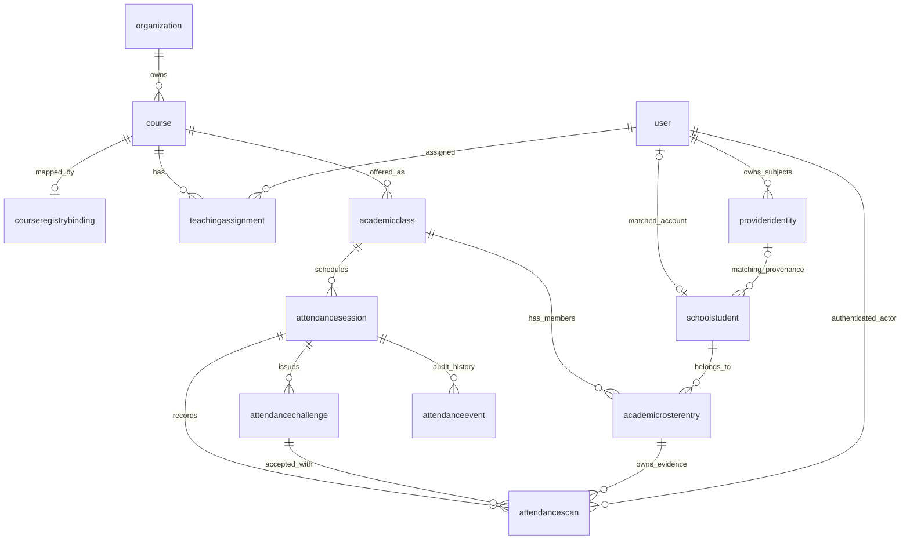

# Custom architecture and database relationships

## Scope and short answer

Our institutional features run **inside the LearnHouse fork**, using the same API
process and PostgreSQL database as LearnHouse. They are not a separate CourseMax
service or a second account/course database. Redis supports short-lived workflow
state; it is not the durable attendance or roster store.

**LearnHouse owns accounts, authentication sessions, organizations, course content,
native access, enrollment and learning progress. Our extension owns institutional
classes, roster identities, scheduled class meetings, QR evidence and attendance
history.** Our provider-subject integration is custom too, but resolves to native
LearnHouse users and the one integrated session authority—not a parallel login.

Here, a **class** is a course offering for a particular academic year, semester and
section. A **class session** is one dated teaching meeting, not a login session or
a native learning-progress run. These class/attendance models are ours, not
upstream LearnHouse functionality in the pinned version we use.

This describes implemented source through application revision `d96f2c6c`.
[Deployment records](deployment.md) identify actual releases and acceptance;
this document is not proof of full institutional parity or permission to migrate
real historical data.

## 1. Ownership boundary

| Area | Authority | How our extension uses it |
| --- | --- | --- |
| Accounts and sign-in sessions | Native LearnHouse account/session system with reviewed fork auth integration | Resolve authenticated native user; never trust a browser-supplied actor ID. |
| Google/LINE subject ownership | Custom `provideridentity` and its immutable events | Bind verified provider subjects to the existing native `user.id`; no email/name-based ownership transfer. |
| Organizations and roles | Native organization, membership and permission system | Check the course's organization and actor permissions on every protected action. |
| Courses, chapters, activities and publication | Native LearnHouse | Reference the native course; do not create a competing content catalog or infer course equivalence from a title. |
| Institutional course mapping, classes and rosters | Custom extension | Store official source facts, reviewed mappings, stable roster identities and membership history. |
| Scheduled meetings and attendance | Custom extension | Store dated sessions, QR challenges, immutable scan receipts and events. |
| Course reading access | Native groups/resources/memberships, administered through a bounded custom adapter | Explicitly reviewed delegation; native authorization remains final. |
| Enrollment and learning progress | Native `trail`, `trailrun`, `trailstep` | Remain separate from roster membership, attendance and READ permission. The bridge does not write or reset them. |

Provider/directory evidence, school association, teaching assignment, authorship,
READ permission and enrollment are distinct. None automatically establishes all
the others. In particular, assigned-teacher READ does not grant editing rights.

## 2. Main database relationships

The following diagram shows declared foreign-key relationships. `o|` marks an
optional parent, such as an unlinked student who has not signed in yet. Actor and
audit links are listed in the table inventory below to keep this diagram readable.



Two important paths are:

```text
attendance scan → session → academic class → native course → native organization
attendance scan → roster entry → school student → native user (when linked)
```

A scan also records its authenticated native `actor_user_id` directly. The service
checks that the actor owns the roster entry; the database separately guards
session/class/challenge/roster/kind consistency. A foreign key by itself does not
prove authorization.

`AcademicClass` and the attendance tables do **not** have their own `org_id` column.
Their organization comes through `AcademicClass.course_id → Course.org_id`.
Organization scope is checked in the service/API, not inferred from a student name,
email domain or directory entry.

## 3. Custom table inventory

These are the current 15 extension-owned SQLModel tables. Physical names are the
existing lowercase names below; they are not a separate database/schema or a
promise that all future institutional features already exist. `?` means nullable;
PK means primary key; FK means database foreign key.

### Provider and school identity — five tables

Source: [`db/provider_identity.py`](../../apps/api/src/route66_ext/db/provider_identity.py),
[`db/provider_profile_import.py`](../../apps/api/src/route66_ext/db/provider_profile_import.py),
[`db/school_identity.py`](../../apps/api/src/route66_ext/db/school_identity.py).

| Table | Keys and links | Responsibility |
| --- | --- | --- |
| `provideridentity` | `id` PK; `user_id → user.id` | Private Google/LINE subject ownership. Unique `(provider, issuer, namespace, subject)`; at most one active identity per user/provider. Retired subjects stay reserved. |
| `provideridentityevent` | `id` PK; `identity_id → provideridentity.id`; `actor_user_id → user.id` | Append-only binding/retirement evidence. |
| `providerprofileimport` | `user_id` PK/FK → `user.id`; `identity_id? → provideridentity.id` | Optional provider profile-import state, retries and private hints; not a second editable user profile. |
| `schoolgoogleevidence` | `identity_id` PK/FK → `provideridentity.id`; `user_id → user.id` | Server-observed verified Google email/domain evidence and observation time; not an institutional approval or role grant. |
| `nrruteacheridentity` | `user_id` PK/FK → `user.id`; `identity_id → provideridentity.id`; unique `officer_id` | Own self-confirmed staff-directory association and source name/code facts. It does not establish teaching permission or account ownership. |

### Course mapping, classes and roster — six tables

Source: [`db/academic_classes.py`](../../apps/api/src/route66_ext/db/academic_classes.py).

| Table | Keys and links | Responsibility |
| --- | --- | --- |
| `courseregistrybinding` | `course_id` PK/FK → `course.id` | Explicit mapping of a native course to an official registrar course ID/code. |
| `teachingassignment` | `id` PK; `course_id → course.id`; `user_id → user.id`; unique `(course_id, user_id)` | Active/inactive **course-level** teaching assignment; not native authorship or a per-session role. |
| `academicclass` | `id` PK; `course_id → course.id` | Year, semester, section, official source identifiers, optimistic version and last accepted source digest/time. |
| `schoolstudent` | `id` PK; `user_id? → user.id`; `identity_id? → provideridentity.id` | Stable institutional student identity, optional exact ten-digit number, source facts and optional matched native account/provenance. A roster student can exist before an account is matched. |
| `academicrosterentry` | `id` PK; `class_id → academicclass.id`; `student_id → schoolstudent.id`; unique `(class_id, student_id)` | Stable class membership, registry/manual source, active/withdrawn state, missing-snapshot counter and display position. |
| `academicclassevent` | `id` PK; `class_id? → academicclass.id`; `student_id? → schoolstudent.id`; `actor_user_id → user.id` | Append-only setup, source/import, membership, identity-conflict, connection and native-access evidence in typed workflow events plus JSON details. |

Additional invariants:

- `academicclass` uniquely identifies `(course_id, academic_year, semester, section)`.
  The official `(registry_course_id, academic_year, semester, section)` is also
  globally unique, preventing another native course from taking the same section.
  The legacy `(registry_class_id, academic_year, semester)` uniqueness is retained.
- `registry_class_id` can be NULL when the official export needs only the real
  course/year/semester and exact section. NULL is not replaced by a fabricated ID.
- Non-null student numbers and matched `schoolstudent.user_id` values are unique.
  Nine-digit hints are not padded; names/personal emails do not prove ownership.
- Official student name/faculty/program facts do not overwrite a user's chosen
  native profile name. Missing source facts must not erase known history.
- Requests before a class exists can use `academicclassevent.class_id = NULL`.
  Connection requests/completions and access configuration/receipts use this event
  history; there is no separate class-connection or learning-access-binding table.
- IDs inside `academicclassevent.details` are **application-validated JSON
  references, not SQL foreign keys**. Their consistency/provenance must be checked.

### Attendance — four tables

Source: [`db/class_attendance.py`](../../apps/api/src/route66_ext/db/class_attendance.py).

| Table | Keys and links | Responsibility |
| --- | --- | --- |
| `attendancesession` | `id` PK; `class_id → academicclass.id`; `created_by → user.id` | One dated meeting: title, start/end, timezone, grace/late thresholds, scheduled/no-class state and version. |
| `attendancechallenge` | `id` PK; `session_id → attendancesession.id`; `created_by → user.id` | Entry/heartbeat QR challenge digest, session version and creation/expiry times. Raw QR tokens are not stored. |
| `attendancescan` | `id` PK; `session_id → attendancesession.id`; `challenge_id → attendancechallenge.id`; `roster_entry_id → academicrosterentry.id`; `actor_user_id → user.id` | Immutable accepted scan, unique public-facing receipt identifier, server arrival time, kind and computed present/late status. |
| `attendanceevent` | `id` PK; `session_id → attendancesession.id`; `actor_user_id → user.id` | Immutable attendance action history and JSON details. |

A unique `(challenge_id, roster_entry_id)` permits one accepted receipt per
challenge/member; a session can have multiple entry/follow-up challenges and scans.
Attendance evidence belongs to the **stable roster entry**, not mutable email or
native course enrollment. Active membership and native actor/organization checks
are required for a new scan.

There is no separate stored `AttendanceRecord`/absence-result table in this slice.
The service projects earliest arrival, latest heartbeat and missing attendance
from sessions/scans. An absent result after session completion is a read-time
projection, not a fabricated scan; no-class sessions are excluded. Full manual
excusal/override and historical eligibility reporting remain separate work.

## 4. Exact links into native LearnHouse

Direct custom-to-core FKs target **`user.id` and `course.id`**. The remaining native
relationships are indirect through the course or created through the access adapter:

| Native link | Mechanism | Important boundary |
| --- | --- | --- |
| Account | Student match, teacher assignment, actor/creator columns and provider identity FKs → `user.id` | No duplicate user store, account merge or email-based evidence reassignment. |
| Course | Class, teaching assignment and registry binding FKs → `course.id` | Course/content/publication remain native. One native course may have multiple academic classes. |
| Organization | `course.org_id → organization.id`; native organization membership/roles checked at runtime | No standalone class organization or school-derived admin role. |
| Course READ permission | `usergroup`, `usergroupresource`, `usergroupuser` through `adapters/native_learning_access.py` | An explicitly approved dedicated group is course-scoped; eligibility combines its classes and approved teacher policy. READ is not edit permission. |
| Content handoff | Native course UUID/routes and native metadata/content authorization | No direct attendance FK to a chapter/activity; no bypass for unpublished content. |
| Enrollment/progress | Existing native `trail`, `trailrun`, `trailstep` | No direct attendance FK or automatic conversion to enrollment, completion, grade or credit. |

Native `usergroupresource.resource_uuid` points logically to `course.course_uuid`;
that string relationship is **not a database FK to `course.id`**. The adapter checks
exact course/group identity, organization, one-course linkage, UUID ambiguity,
permissions, applicable plan and quota before provisioning or adoption.

The bridge records approved group identity and exact owned membership receipts
`(id, user_id, creation_date)` in append-only academic events. Repairs may remove
only provably bridge-owned matching memberships, never unrelated manual/recreated
rows. Successor configurations reference their predecessor; old evidence remains.
Adding the first group can restrict native organization-wide private-course fallback,
so review must disclose that effect and preserve intended manual readers explicitly.

## 5. Write flows and authorization

### Connect class and acquire roster

1. Signed-in teacher selects an exact section from their own confirmed timetable.
2. Administrator explicitly chooses the equivalent private native course and
   reviews the automatically retrieved exact-section roster count/access effect.
3. Confirmation validates the preview fingerprint and source again, then saves
   mapping/assignment/class/initial roster and approved access setup in one
   caller-owned transaction. Source failure/staleness cannot partially connect.
4. Existing class IDs use the fixed official CP874 HTML source; absent IDs use the
   official course/term RTF export filtered to the exact section—not all groups.
5. Reviewed subsequent imports preserve manual decisions and stable IDs; withdrawal
   requires two accepted missing snapshots. Fetch failure is not withdrawal.

Source facts do not themselves grant native roles, authorship or enrollment. Access
reconciliation uses a savepoint so optional access failure can become a precise
repair task without undoing accepted evidence or preventing authentication.

### Record attendance

1. An authorized assigned teacher/admin creates a dated session under a class.
2. Staff opens a short-lived challenge; only its token digest is persisted.
3. The native-authenticated student submits the token. The service rechecks
   organization, active roster ownership, identity conflicts, session state/version,
   token expiry and timing policy under the shared academic transaction lock.
4. A successful request writes a scan and audit event. An authorized duplicate
   returns the original receipt rather than inventing additional attendance.
5. Students receive only their own receipts; staff-only history and peer identities
   are not exposed by the student or QR-display projection.

Private reads use no-store responses; mutations require the exact configured origin
and native-session protections. There is no portal-session copying, actor-header
impersonation, runtime CourseMax call or proactive LINE send in these flows.

## 6. Integrity, migrations and recovery

- Academic events are append-only with PostgreSQL update/delete guards. Attendance
  challenges/scans/events additionally block truncate. Do not assume the academic
  event table has the same truncate trigger. Provider ownership/event guards retain
  retired subjects and prohibit silent ownership changes. These are application/data
  integrity protections, not a claim that a database administrator cannot alter DDL.
- Attendance schedules are retained: their class/title/times/timezone/thresholds/
  creator cannot be rewritten. Scheduled/no-class state and version can advance;
  retained scan evidence is not deleted when a class does not meet.
- Scan-scope DB guards complement service authorization. The shared advisory
  transaction lock coordinates cooperating identity, roster, access and attendance
  writers; native manual access changes still require exact-row reconciliation.
- Native deletion paths must respect academic/provider retention **before**
  filesystem side effects. A foreign key alone cannot recover already deleted files.
- Model registration is explicit in
  [`bootstrap.py`](../../apps/api/src/route66_ext/bootstrap.py). Compatibility modules
  in native discovery locations delegate to these same classes; they do not define
  a second set of tables. Importing the extension is not permission to run migrations.

The owned revision sequence after native `b6e199d023f8` is:

```text
c71a02d9ef40  provider subject ownership/events
  → d84e13a6b902  native Google email uniqueness safeguard
  → e92d7f04ab16  optional profile-import state
  → f14b820c7d11  school evidence/directory association
  → f25c930d8e22  course mapping, classes, roster and academic events
  → f36da41e9f33  attendance sessions/challenges/scans/events
  → f47eb52fa044  nullable class ID and unique official course/term/section
```

Historical revision wrappers remain in native migration discovery locations; their
implementations are extension-owned. New owned versions are composed explicitly by
[`migrations/config.py`](../../apps/api/src/route66_ext/migrations/config.py).
Do not load historical implementations twice or stamp an inferred native head.
Existing staging bootstrap schema is unversioned; the checked named source-migration
runner and isolated-restore rehearsal are described in the acquisition document.
`create_all` is not an existing-schema migration strategy.

Recovery requires protected backups, isolated restore/migration verification and
an exact compatible saved app. **Never restore an old live database/content snapshot
to roll back application code or erase new academic evidence.** The pre-acquisition
app rollback refuses once a NULL-ID source class exists; forward-repair instead.

## 7. Code map and remaining scope

| Surface | Location |
| --- | --- |
| Custom models | `apps/api/src/route66_ext/db/` |
| Workflow/services | `apps/api/src/route66_ext/services/` |
| Native integration adapters | `apps/api/src/route66_ext/adapters/` |
| Custom API | `/api/v1/school-identity`, `/api/v1/academic-classes`, `/api/v1/attendance`, provider auth routes |
| Custom UI | `apps/web/extensions/route66/` with reviewed native route/shell delegates |
| Migrations and deployment checks | `apps/api/src/route66_ext/migrations/`, `deploy/staging/` |

Implemented attendance is the session/QR/receipt/no-class slice, not full attendance
parity. Unattended roster refresh, calendar-week/rotation/holiday/makeup-derived
dated planning, persisted identity-case resolution, manual attendance overrides,
historical withdrawal eligibility and aggregate reporting still require work.
A weekly timetable does not establish dates. The custom syllabus/teaching-plan and
broader assessment/governance requirements are not implemented by these 15 tables.
No real historical migration or production cutover is implied.

Related documentation:

- [Extension development and native boundary](development.md)
- [Attendance behavior, policy and acceptance](../attendance-port.md)
- [Automatic NRRU acquisition and migration](nrru-automatic-acquisition.md)
- [Native access bridge and recovery](learning-access.md) — its original 7bf6ed1f
  workflow is historical; URL-free acquisition above supersedes its pasted-link step.
- [Extraction and compatibility delegates](extraction.md)
- [Release evidence and actual acceptance](deployment.md)
- [Remaining delivery sequence](goal-completion-sequence.md)

When changing a model, FK, event contract or ownership boundary, update this document
alongside the corresponding tests and migration. Keep real student records, provider
subjects/tokens, passwords and private operational evidence out of documentation.
